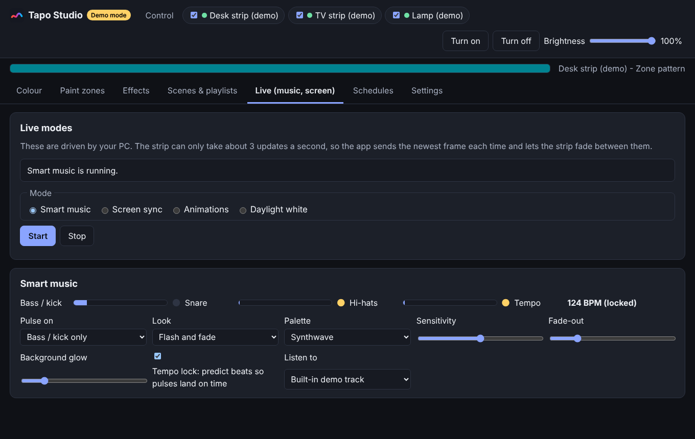
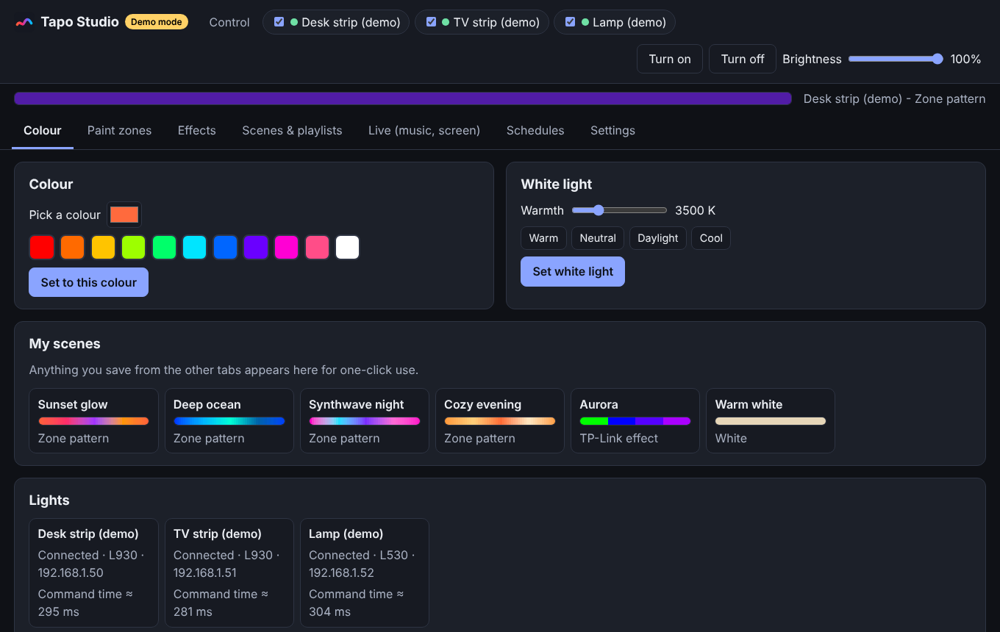
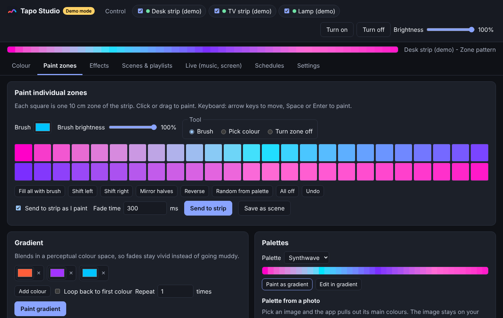
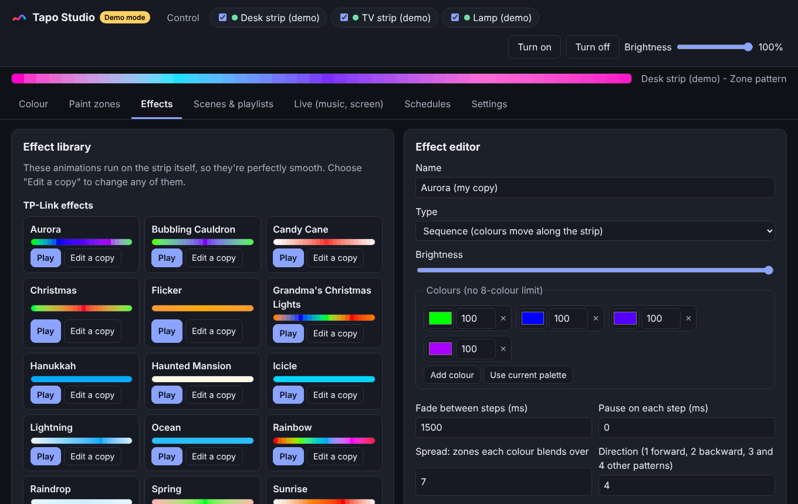
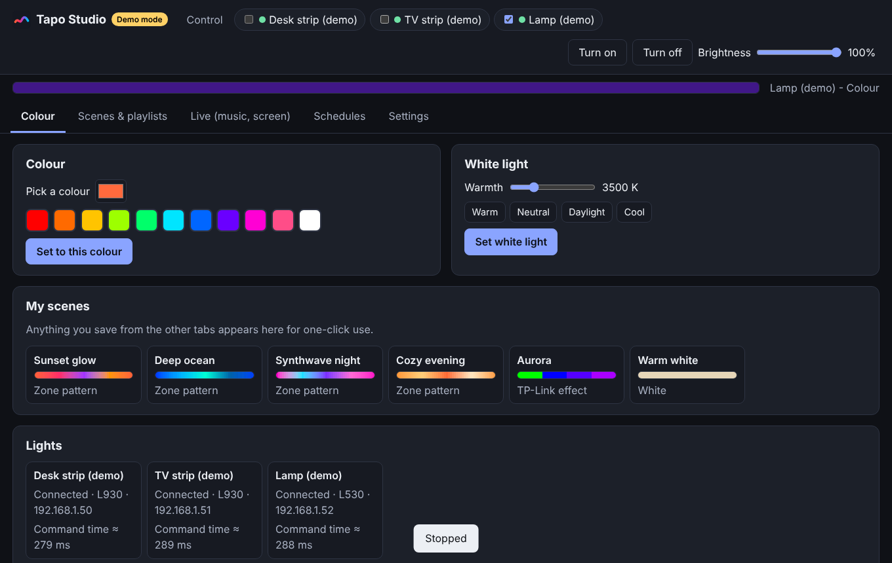

# Tapo Studio

**Far more control than the Tapo app for your TP-Link Tapo light strips.** A local web app that runs on your own computer and talks to your lights directly over your home network. No cloud, no tracking, no extra account.

[](https://github.com/Bambob01/tapo-studio/actions/workflows/ci.yml)
[](LICENSE)


https://github.com/user-attachments/assets/a7111210-1ab0-46ce-b4cf-782935c5a8e8

Real footage: an L930-5 strip driven by Tapo Studio. Contains flashing lights.



> **Newer firmware (1.4.x):** custom effects are sent the way that firmware accepts, using the closest scene animation, so they may look a little different from the editor. If the light refuses the animation, the app shows the colours still and tells you.
>
> **Status: alpha.** It was built and tested against a simulated light and a strict model of the [`tapo`](https://github.com/mihai-dinculescu/tapo) library, and it has not yet had wide testing on real hardware. If you try it on your lights, please [tell us how it went](https://github.com/Bambob01/tapo-studio/issues/new?template=device_report.yml). That's how the table below gets verified.

## What you can do

| | |
|---|---|
| **Paint every zone** | Colour each of the L930's 50 zones (10 cm each) by mouse or keyboard, turn zones off, shift/mirror/reverse, and blend gradients in a perceptual colour space so they stay vivid instead of going muddy. Pull a palette from any photo. |
| **Edit every effect** | All 17 TP-Link effects, editable. 14 extra effects (candle, fireplace, fireflies, lava lamp, northern lights...). An effect editor that exposes every setting the strip accepts: unlimited colours (the app stops at 8), fade times in milliseconds, spread, direction, random hue/saturation/brightness ranges. Raw JSON import and export. |
| **Scenes & playlists** | All 55 built-in scene animations, your own saved scenes, and playlists that cycle through them. |
| **Smart music** | Reacts to what's playing on your PC. Separate **kick/bass**, **snare**, **hi-hat** and **vocal** detection, so you can pulse on the bass only. It auto-adjusts to quiet and loud songs, finds the tempo and **predicts the next beat**, so pulses land on time even though the strip takes ~0.3 s to respond. |
| **Screen sync** | Ambilight-style: the strip follows the colours at the edge of your screen. |
| **Daylight white** | Warm and dim when you wake, cool and bright at midday, warm again before bed. |
| **Schedules** | Run scenes, effects, playlists or on/off at set times. The built-in Sunrise effect makes a good wake-up light. |
| **Several lights** | Control any mix of lights together, or join strips into one long strip for the live modes. |

<details>
<summary>More screenshots</summary>

| | |
|---|---|
|  |  |
|  |  |

Screenshots were taken in demo mode (`--mock`), so they show simulated lights.
</details>

## Supported lights

The `tapo` library exposes very different features for different models, so Tapo Studio shows only what each light can do.

| Light | Status | What you get |
|---|---|---|
| **L930** (L930-5, L930-10) | Primary target | Everything above |
| **L920** | Expected to work (same library code as the L930), untested | Everything above |
| L900 light strip | Experimental | Colour, white, brightness |
| L430, L530, L535, L630 colour bulbs | Experimental | Colour, white, brightness. Live modes show the average colour |
| L510, L520, L610 white bulbs | Experimental | On/off and brightness |

Per-zone painting and effects are only available on RGBIC strips (L920/L930), because that's what the library supports. Other Tapo devices (plugs, hubs, sensors, cameras) aren't lights and aren't supported. Support for other brands is possible: see [CONTRIBUTING.md](CONTRIBUTING.md#adding-a-new-kind-of-light).

## Quick start

### Windows

1. Install **Python 3.11 or newer** from <https://www.python.org/downloads/windows/> (tick **"Add python.exe to PATH"**).
2. Put this folder somewhere inside your own user folder (for example `Documents`), then double-click **`start.bat`**. The first run sets everything up (about a minute) and asks whether to install the Smart Music and Screen Sync extras.
3. Your browser opens the control panel. Go to **Settings**, enter your Tapo email and password, and press **Search my network**.

Want to look around first? Run **`start-demo.bat`** for pretend lights, with no hardware or login needed.

Keep the black window open while you use the app. If you close the browser tab, reopen it using the private link shown in that window.

### Windows, macOS and Linux with pip

```bash
git clone https://github.com/Bambob01/tapo-studio
cd tapo-studio
python -m venv .venv
source .venv/bin/activate          # Windows: .venv\Scripts\activate
pip install -e ".[all]"            # ".[all]" adds music and screen sync; use "." for the basics

tapo-studio --mock                 # try it with pretend lights
tapo-studio                        # use your real lights
```

Options: `--mock` (demo lights), `--port 8765`, `--no-browser`, `--debug`, `--version`.

Smart music listens to "what's playing" using WASAPI loopback on Windows and a PulseAudio/PipeWire monitor on Linux. macOS has no built-in loopback: use a virtual device such as BlackHole as the input and choose **Microphone** in the app. Linux and macOS are untested so far.

### First-time set-up

- Use the **same Tapo email and password** as in the Tapo app. They're case-sensitive.
- Your computer must be on the **same network** as the lights.
- If you see **"Login refused"** or **"FORBIDDEN"**: in the Tapo app go to **Me → Third-Party Services → Third-Party Compatibility** and switch it to the opposite setting, wait a minute, then press **Reconnect all**. Don't keep retrying a wrong password, because the light can lock you out for a while.
- Give each light a fixed IP address (a "DHCP reservation") in your router, so its address never changes.
- **Painting does nothing?** Some firmware (seen on an L930 with firmware 1.4.3) accepts the usual painting request but never applies it. The app notices by reading back what the strip is showing and switches to the request that firmware does apply. If it still doesn't work, go to **Settings → Troubleshooting → Fix painting**: the app tries each way of painting and you confirm which one shows a red and blue test pattern.
- **Something not working?** Go to **Settings → Troubleshooting → Run diagnostics**. It checks each light, flashes a red/blue test pattern and writes a report with no passwords or full IP addresses, which you can paste into an issue. After every paint, the app also asks the strip whether it is really showing the pattern, and tells you if it isn't.

## How it works, and its limits

Tapo Studio is a small Python web server (Starlette) plus a plain HTML/JS page, using the [`tapo`](https://github.com/mihai-dinculescu/tapo) library to talk to the lights. Everything stays on your machine.

**The strip accepts about 3 updates per second.** Each command is an encrypted request that takes roughly 0.3 s to apply, and that's a limit of the hardware, not the app. So:

- **Effects run on the strip itself** and are perfectly smooth. Use them when you want smooth motion.
- **Live modes are driven by your PC.** The app keeps one request in flight, always sends the newest frame, skips frames that wouldn't look different, and tells the strip to fade between frames. Very fast drum rolls will blur together.
- For music, the beat predictor sends each pulse early enough to land on the beat, and **Music sync offset** (Settings) fine-tunes it.

Smart music uses signal processing, not machine learning: per-band spectral flux with an adaptive threshold, a "sudden rise in energy" gate so a moving bassline isn't mistaken for a kick, autocorrelation for tempo, and a phase-locked loop to track the beat. The tests in `tests/test_audio.py` run it against synthetic songs.

## Security and privacy

Tapo Studio is designed to be safe to leave running on a home PC. It was reviewed with real attack scripts against a running copy, and the issues found were fixed (details in [SECURITY.md](SECURITY.md)). That was an AI-assisted review, **not a professional audit**.

- **Only this computer can reach it.** It listens on `127.0.0.1` only.
- **A private key is needed.** It's created each time the app starts and passed to your browser in the link's `#` fragment, which browsers never send over the network. Other programs and other user accounts on your PC can't fetch it, and other websites can't use the app.
- **Your Tapo password** is encrypted with Windows DPAPI, stored in your own profile folder, never shown back, and **only sent to your lights**. Searching your network never sends it anywhere. Each light's hardware ID is remembered, and a different device that takes over its IP address won't receive your login.
- **No cloud, analytics, cookies, fonts or scripts from the internet.**
- Only home-network addresses are accepted for lights, and every input is validated.

On Linux and macOS the password is *not* encrypted at rest (the settings file is readable only by you). See [SECURITY.md](SECURITY.md) for the full picture.

## Roadmap

Ideas, roughly in order of how well they suit the strip. Contributions welcome:

- Alerts that flash and then restore your scene (notifications, "on a call" light)
- Colours from the album art of whatever is playing
- Syncing several strips as one, with per-strip calibration
- Natural-language scenes ("a sunset over the ocean") that fill in effect settings
- Receiving sACN/DDP so OpenRGB, LedFx or Hyperion can drive the strip
- A local API / MCP server for Home Assistant, Stream Deck and AI agents
- OS keyring storage for the password on Linux and macOS

## Contributing

Bug reports, hardware reports and pull requests are all welcome. See [CONTRIBUTING.md](CONTRIBUTING.md). The demo mode makes it easy to work on the UI without any lights.

```bash
pip install -e ".[dev]"
python -m pytest
```

## Licence and credits

[MIT](LICENSE). Built on the open-source [`tapo`](https://github.com/mihai-dinculescu/tapo) library by Mihai Dinculescu, and informed by [tapoviz](https://github.com/The-DarkMatter/tapoviz), which pioneered audio and screen reactive control of these strips. Full list in [NOTICE.md](NOTICE.md).

**Tapo Studio is an independent project. It is not affiliated with, endorsed by, or sponsored by TP-Link.** "Tapo" and "TP-Link" are trademarks of their owners. Use it at your own risk: it sends commands to your devices, and the authors can't promise that every firmware version behaves the same way.
